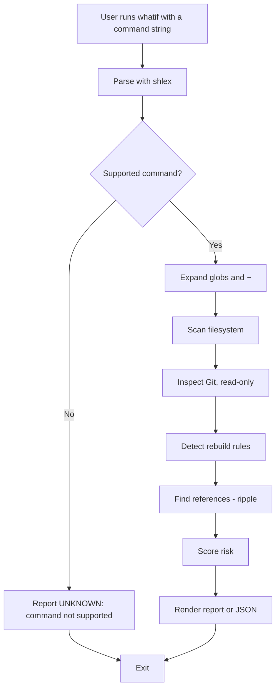

# `whatif`

> `whatif` previews a shell command without running it, then tells you how much of what it would destroy can be **recovered, rebuilt, or is lost for good**, backs up only the unrecoverable part, and checks its own predictions afterward.

**Team:** Tanvi Sharma, Farida Khan
**Repository:** https://github.com/tanvisharma252031/whatif_linux_command/tree/main
**Date:** 28-10-2026

---

## 1. The problem

### What we keep doing by hand

Before running a destructive command, we manually try to work out what it will hit and whether we could get it back:

```bash
ls -la build/*                 # what does the glob match?
git status                     # anything modified or untracked in there?
git check-ignore -v .env       # is this file ignored (so Git can't restore it)?
cat Makefile | grep clean      # can this be rebuilt?
grep -rn "config.json" .       # does anything depend on it?
cp -r ./project ../project.bak # "just in case" full copy
rm -rf ./build/*
```

The problem is the gap between "what will this touch?" and "what can I get back?". A one-character typo (`rm -rf ./build/*` vs `rm -rf ./build /*`) changes the outcome completely, and the shell gives no warning before it acts.

### Evidence that this is real

```bash
history | grep -E "rm -rf?|rm -fr" | wc -l
history | grep -E "git status" | wc -l
```

### Who else has this problem

---

## 2. Prior art: what already exists

### Tools we found and actually tried

| Tool | Where we found it | What it does | Why it does not solve our problem |
|---|---|---|---|
| `maybe` | Web search | Shows the file operations a command would perform | Previews what is touched; does not say what is recoverable. |
| `rx` | Web search | Scans for danger patterns, diffs `sed -i`, offers dry-run variants | Warns about danger; no recoverable/irreplaceable split. |
| `gynx` | Web search | Confirmation prompt plus diff for overwrites | Asks "are you sure?" but not "can you get it back?". |
| `cpbar` | Web search | Dry-run for `cp`/`mv`/`rm` | Shows affected files only. |
| `git clean -n`, `rsync -n` | Built in | Native dry runs | Each covers one tool; neither classifies recoverability |

### Evidence of trying them

```bash
maybe rm -rf ./build/*
```

### Where we searched

- [ ] `man -k <keyword>`
- [ ] GitHub search
- [ ] Homebrew: `brew search <keyword>`
- [ ] Stack Overflow
- [ ] npm / PyPI
- [ ] Asked a human

### The gap, in one sentence

"Existing tools can **show which files a command would touch or ask for confirmation before it runs**, but none of them **classify those files by whether they can be recovered, rebuilt or are lost for good, back up only the unrecoverable ones, and check their own predictions afterward**, which is the part that actually costs us time."

*To our knowledge, no existing tool does this. "Not found" means not found in the sources we checked, not proven absent.*

| | `whatif` | Typical preview / confirm tools |
|---|---|---|
| Shows affected files | ✓ | ✓ |
| Recoverable / regenerable / irreplaceable split | ✓ | not found |
| Rebuild evidence from the project | ✓ | not found |
| Backs up only what nothing else can restore | ✓ | not found |
| Downstream references with cited evidence | ✓ | not found |
| Checks its own predictions afterward | ✓ | not found |
| Says UNKNOWN instead of guessing | ✓ | not found |

---

## 3. What we are building

### In scope

- **Recovery-gap report (`--oops`)**: for each affected file, one of **Recoverable** (tracked by Git, unmodified), **Regenerable** (ignored by Git and the project has a rebuild rule), or **Irreplaceable** (untracked, ignored with no rebuild rule, or locally edited tracked files), with evidence per file.
- **Just-in-time backup (`--guard`, `--restore`)**: copies only the irreplaceable files to `.whatif/backups/`. The tool never runs the original command.
- **Prediction receipts (`--verify`)**: after the user runs the command themselves, rescans the paths and compares predicted vs actual.
- **Explanations (`--why`)** and **ripple analysis (`--ripple`)**: which rules fired, and which scripts/configs reference the target (one hop, with file, line, match and confidence).
- **Supported commands:** `rm` and `sed -i` fully; `git clean`, `mv`, `cp`, `chmod` later.

### Out of scope

- **Executing the command.** `whatif` is preview-only; running it is always the user's decision. This is also what makes the demo safe.
- **Predicting shell features** (`$VAR`, `$(...)`, pipes, `eval`, aliases, functions). These are reported as UNKNOWN, because guessing would be worse than saying so.
- **Judging whether an untracked file matters.** Git cannot know this, so the tool flags potential loss and the user decides.
- **Wide command coverage.** Doing a few commands accurately beats many commands loosely.
- **AI or cloud APIs.** Everything is local and offline.

### How we will know it worked

"This tool is successful if it turns **five manual checks (`ls`, `git status`, `git check-ignore`, Makefile lookup, `grep` for references) plus a full manual backup** into **one `whatif --oops` command and one `--guard`**, and we actually use it after the assignment ends."

Measured by the ground-truth test (Section 5): for each supported case, the real command is run in a temp copy and compared with the prediction. We report cases tested, exact, over-predicted, under-predicted, and correctly marked UNKNOWN.

---

## 4. Tech stack

| Choice | What we picked | Why, and what we rejected |
|---|---|---|
| Language | Python 3 for analysis, Bash for the command wrapper | Python gives safe parsing (`shlex`), filesystem walking and structured output. Rejected pure Bash: too fragile for parsing quoted paths and building JSON. |
| Argument parsing | `argparse` (stdlib) | No install needed. Rejected `click`: nicer, but adds a dependency for little gain. |
| Other dependencies | None; Git CLI called read-only | Keeps install trivial and offline. Rejected GitPython: extra dependency and a larger attack surface than a few fixed read-only commands. |
| Testing | `pytest` with temporary test repos | Easy fixtures via `tmp_path`; fits the copy-run-compare ground-truth test. |
| Packaging / install method | `pip install -e .` with a `pyproject.toml` entry point | Standard and needs no extra tooling. Rejected a single copied script: no clean `whatif` command on the PATH. |

### Why this language

Python 3 has `shlex` and `pathlib` in the standard library, and the analysis (Git state, rebuild rules, risk scoring) is data processing that Bash handles poorly.

### What we are deliberately not using

Pure Bash: parsing shell-quoted input and handling spaces in filenames safely is exactly what Bash is bad at. We also never pass the user's string to a shell, `eval`, `os.system` or `subprocess`.

---

## 5. Architecture



### Components

Proposed layout; adjust to match your repo.

| Part | Responsibility | File |
|---|---|---|
| CLI | Flags, exit codes, output mode | `whatif/cli.py` |
| Parser | `shlex` split, support check, glob/`~` expansion | `whatif/parser.py` |
| Scanner | Walk target paths, handle symlinks and permissions | `whatif/scan.py` |
| Git inspector | Tracked / modified / ignored status (fixed read-only commands) | `whatif/gitinfo.py` |
| Rebuild detector | Makefile `clean`, `node_modules`+lockfile, `venv`+`requirements.txt`, `__pycache__` | `whatif/rebuild.py` |
| Classifier and risk | Three-way split, risk rules, `--why` evidence | `whatif/classify.py` |
| Guard | `--guard` backup and `--restore` | `whatif/guard.py` |
| Verify | `--verify` predicted-vs-actual comparison | `whatif/verify.py` |
| Ripple | One-hop reference search | `whatif/ripple.py` |
| Renderer | Text and `--json` output | `whatif/render.py` |

### Data flow

The input is a command string (never executed) plus the current filesystem and Git state. The tool parses it, expands it to a concrete file list, classifies each file using Git status and project rebuild rules, scores risk, and prints a report or JSON. Every statement is labelled **PREDICTED** (supported syntax plus current state), **POSSIBLE** (evidence-backed, not guaranteed) or **UNKNOWN** (cannot be determined). The lowest rating is LOW, never "safe."

### Risk rules

| Rule | Effect |
|---|---|
| Recursive operation | +1 level |
| Target is `/`, `~`, `.` or outside the project | HIGH |
| Contains modified tracked files | HIGH |
| Contains irreplaceable files | at least MEDIUM; HIGH if edits would be lost |
| Only recoverable files | LOW |
| Overwrites an existing file | at least MEDIUM |
| Unsupported syntax | UNKNOWN |

With no evidence, a file defaults to **Irreplaceable**, the cautious choice.

### What happens when things go wrong

| If this happens | The tool does this |
|---|---|
| Command uses `$VAR`, `$(...)`, pipes or `eval` | Marks it UNKNOWN and refuses to guess |
| Not inside a Git repository | Skips Git evidence; files default to Irreplaceable and the report says why |
| Target does not exist, or glob matches nothing | Reports "nothing matched" instead of a misleading empty LOW |
| Permission denied while scanning | Reports the path as unreadable and treats it as Irreplaceable |
| Files change between preview and run (time-of-check vs time-of-use) | Documented limitation; `--verify` shows the real difference |

### Evaluation plan

1. **Ground-truth test:** copy a test repo to a temp folder, run the real command there, compare actual change with prediction.
2. **Edge cases:** spaces in filenames, dotfiles, symlinks, empty directory, nonexistent target, permission denied, `--`, a glob that matches nothing, `rm` on a directory without `-r`.
3. **Safety test:** preview a command that would create a marker file and check the file never appears.

### Honest limitations

- Time-of-check vs time-of-use: files can change between preview and run.
- Shell features can't be predicted statically.
- Git can't know whether an untracked file matters.
- `--ripple` finds explicit references only; runtime-built paths are missed, and a hit means "may be affected," not "will break."
- `--verify` is approximate if something else changes those paths in between.

---

## 6. Usage

### Synopsis

```
whatif [options] '<command string>'
whatif --restore
```

The command string is analysed, never executed. `whatif` is therefore always safe to run live; there is no separate `--dry-run`.

### Commands and flags

| Flag | Long form | What it does | Default |
|---|---|---|---|
| `-h` | `--help` | Show usage and exit | |
| `-v` | `--verbose` | More output | off |
| | `--oops` | Recoverable / regenerable / irreplaceable report with evidence | on for `rm` |
| | `--why` | Print which rules fired and the evidence behind each | off |
| | `--ripple` | Find scripts/configs referencing the target (one hop) | off |
| | `--guard` | Back up only irreplaceable files to `.whatif/backups/` | off |
| | `--restore` | Restore files from the latest backup | |
| | `--verify` | After you run the command, compare predicted vs actual | off |
| | `--diff` | In-memory diff for simple `sed -i` substitutions | off |
| | `--json` | Structured output, always with `"executed": false` | off |
| | `--fail-on high` | Exit non-zero when risk is HIGH | off |

### Examples

**Basic use**

```bash
$ whatif --oops 'rm -rf .'
```

```
RISK: HIGH  (target is ".", recursive)
RECOVERABLE   (PREDICTED)  41 files   tracked, unmodified
REGENERABLE   (PREDICTED)  312 files  build/ (Makefile 'clean' target)
IRREPLACEABLE (PREDICTED)  6 files
  .env              ignored, no rebuild rule
  notes.txt         untracked
  src/app.py        tracked, locally modified
Nothing was executed.
```

**With a flag**

```bash
$ whatif --guard 'rm -rf .'
# backs up the 6 irreplaceable files, you run the delete yourself, then:
$ whatif --restore
$ whatif --verify 'rm -rf .'
```

**When it can't know**

```bash
$ whatif 'rm -rf $DIR/*'
```

```
UNKNOWN: command contains $DIR; cannot be determined statically.
Nothing was executed.
```

**When it fails**

```bash
$ whatif --nonsense
```

```
whatif: error: unrecognized arguments: --nonsense
usage: whatif [options] '<command string>'
```

### Exit codes

| Code | Meaning |
|---|---|
| 0 | Success (report produced) |
| 1 | `--fail-on high` was set and risk is HIGH |
| 2 | Usage error (bad flags or missing command string) |
| 3 | Internal or environment error (e.g. cannot write `.whatif/backups/`) |

### Installation

```bash
git clone <your repo>
cd <your repo>
pip install -e .
whatif --help
```

---

## 7. References

- `maybe`: shows file operations a command would perform; closest prior art
- `rx`: danger-pattern scan, `sed -i` diff, dry-run variants
- `gynx`: confirmation prompt plus diff for overwrites
- `cpbar`: dry-run for `cp`/`mv`/`rm`
- `git clean -n` and `rsync -n` documentation: built-in dry runs we compared against
- Python `shlex`, `argparse`, `pathlib` docs: parsing without invoking a shell
